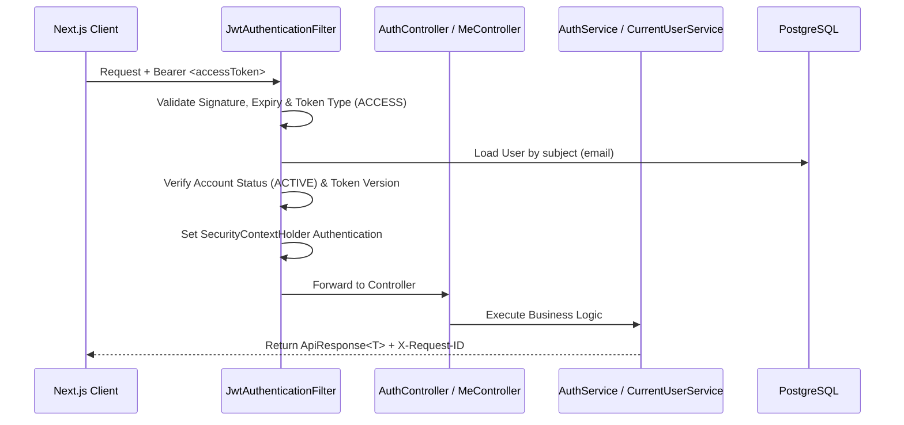

# PawConnect Backend — Phase 1: Authentication & Authorization Architecture

## 1. Overview & Architectural Goals

The Phase 1 implementation equips PawConnect with an enterprise-grade, stateless, JWT-based security and authorization infrastructure to serve the Next.js frontend (`http://localhost:3000`).

The backend implements:
- Stateless authentication with 15-minute access tokens and 7-day refresh tokens.
- Instantaneous token revocation via a database-backed `token_version` model (zero additional tables required).
- Strict role-based access control (`PET_OWNER`, `VETERINARIAN`, `SERVICE_PROVIDER`, `ADMIN`) with absolute exclusion of Vendor/Marketplace concepts.
- Reusable resource ownership enforcement (`AuthorizationService`, `CurrentUserService`).
- Correlation tracking via `X-Request-ID` and MDC.
- In-memory rate limiting and secure 6-digit OTP verification.

---

## 2. Authentication Flow

---

## 3. Registration Flow

- **Endpoint**: `POST /api/auth/register`
- **Security**: Public route.
- **Workflow**:
  1. Rate limiter checks IP threshold (10 req/min).
  2. DTO validation ensures non-blank names, email format, phone format, and password complexity.
  3. Service verifies `password == confirmPassword`.
  4. Service validates uniqueness of email and phone via repository queries. Throws `DuplicateResourceException` if duplicated.
  5. Password is hashed using BCrypt.
  6. The `ROLE_PET_OWNER` entity is resolved and assigned. **Any role parameters in the client request are ignored**, preventing role escalation.
  7. The user record and `user_roles` association are persisted in a single transaction with `accountStatus = ACTIVE` and `tokenVersion = 1`.
  8. An access token (15 min) and refresh token (7 days) are generated.
  9. Response is returned with `201 CREATED` status containing `AuthResponse`.

---

## 4. Login Flow

- **Endpoint**: `POST /api/auth/login`
- **Security**: Public route.
- **Workflow**:
  1. Rate limiter checks IP threshold (10 req/min).
  2. DTO validated for required fields.
  3. User looked up by email. If not found, throws `BadCredentialsException("Invalid email or password")` to prevent user enumeration.
  4. User account status checked: if `SUSPENDED` or `BANNED`, throws `ForbiddenException`.
  5. BCrypt password verification via Spring Security `AuthenticationManager`.
  6. On success, `lastLoginAt` timestamp is updated in PostgreSQL.
  7. Access and refresh tokens generated containing user ID, subject, active roles, and current `tokenVersion`.
  8. Returns `AuthResponse` mapped to clean DTOs.

---

## 5. Refresh-Token Flow

- **Endpoint**: `POST /api/auth/refresh`
- **Security**: Public route (accepts valid refresh token in body).
- **Workflow**:
  1. Validates refresh token signature, expiry, and ensures `token_type == REFRESH`.
  2. Extracts user email and checks DB user status.
  3. Compares JWT `token_version` against DB `user.tokenVersion`. If mismatched (due to logout, password reset, or admin block), rejects with 401 Unauthorized.
  4. Rotates tokens: generates a fresh 15-minute access token and a fresh 7-day refresh token.

---

## 6. Logout Flow

- **Endpoint**: `POST /api/auth/logout`
- **Security**: Public / Authenticated.
- **Workflow**:
  1. Identifies the user from either the authenticated `SecurityContextHolder` or by parsing the provided refresh token.
  2. Increments `user.tokenVersion` (`tokenVersion = tokenVersion + 1`) and saves to DB.
  3. This single atomic operation instantaneously revokes the active refresh token and prevents any existing access tokens from being accepted once validated against the database.
  4. Returns `200 OK` with null data payload.

---

## 7. Forgot-Password Flow

- **Endpoint**: `POST /api/auth/forgot-password`
- **Security**: Public route.
- **Workflow**:
  1. Rate limiter checks IP threshold (5 req/min).
  2. Looks up user by email.
  3. If user exists and is active, generates a secure 6-digit numeric OTP via `OtpService` (TTL: 5 minutes) and enforces a 60-second cooldown between resend requests.
  4. Always returns the generic message: `"If an account exists with this email, a verification OTP has been sent."` (Defends against account enumeration).
  5. OTP values are never logged or exposed in server output.

---

## 8. OTP Architecture

- **Engine**: `OtpService` / `InMemoryOtpService` (abstracted for seamless Redis migration in production).
- **Entropy**: `SecureRandom` 6-digit numeric generation (`100000` to `999999`).
- **TTL**: 5 minutes window.
- **Attempt Limit**: Maximum 3 verification attempts per OTP; automatically invalidated upon 3rd failure.
- **Throttling**: 60-second cooldown before a new OTP can be requested for the same email.
- **Storage**: Keyed by email with attempt count and expiration timestamp; thread-safe with `ConcurrentHashMap`.

---

## 9. Password Reset Flow

- **Endpoint**: `POST /api/auth/reset-password`
- **Security**: Public route (requires one-time `resetToken` obtained from `POST /api/auth/verify-otp`).
- **Workflow**:
  1. `VerifyOtpRequest` validates the 6-digit OTP and returns an ephemeral UUID `resetToken` with a 15-minute lifetime.
  2. `ResetPasswordRequest` supplies email, `resetToken`, `newPassword`, and `confirmPassword`.
  3. Service verifies password match and complexity.
  4. Validates and consumes the `resetToken` via `OtpService` (single-use).
  5. Hashes new password with BCrypt.
  6. Increments `user.tokenVersion` to invalidate all active sessions across all devices.
  7. Persists updated user credentials.

---

## 10. JWT Claims Architecture

Every token generated by `JwtService` includes:

| Claim Key | Value | Purpose |
|---|---|---|
| `sub` | `user.getEmail()` | Standard JWT subject (unique identifier for authentication) |
| `user_id` | `user.getId()` | Numeric primary key for database correlation |
| `roles` | `["ROLE_PET_OWNER", ...]` | Granted authorities array |
| `token_type` | `ACCESS` or `REFRESH` | Enforces token usage boundaries |
| `token_version` | `user.getTokenVersion()` | State validation & instant revocation |
| `iat` | Unix timestamp | Issued-at time |
| `exp` | Unix timestamp | Expiration time (15m for ACCESS, 7d for REFRESH) |

---

## 11. Role Model & Constraints

Active PawConnect roles:
- `ROLE_PET_OWNER`
- `ROLE_VETERINARIAN`
- `ROLE_SERVICE_PROVIDER`
- `ROLE_ADMIN`

**Marketplace/Vendor Absolute Scope Rule**:
- No `ROLE_VENDOR` exists.
- No seller registration or vendor marketplace endpoints exist.
- All products are PawConnect-owned and managed solely by `ROLE_ADMIN`.

---

## 12. Ownership Authorization Model

To ensure strict data privacy and isolation without duplicating database lookup code in controllers, `AuthorizationService` provides centralized verification:

- `requireCurrentUser(Long userId)`: Ensures the caller is accessing their own profile (or is an `ADMIN`).
- `requirePetOwner(Long petId)`: Verifies pet belongs to the caller.
- `requireAddressOwner(Long addressId)`: Verifies address belongs to the caller.
- `requireOrderOwner(Long orderId)`: Verifies order was placed by the caller.
- `requireAppointmentAccess(Long appointmentId)`: Allows only the pet owner, the assigned vet, or an `ADMIN`.
- `requireBookingAccess(Long bookingId)`: Allows only the pet owner, the assigned provider, or an `ADMIN`.

All checks throw `ForbiddenException` if unauthorized.

---

## 13. Public vs. Protected Route Configuration

Configured in `SecurityConfig.java`:

### Public Routes:
- `/api/auth/**` (register, login, refresh, logout, forgot-password, verify-otp, reset-password)
- `/api/public/**`
- `/swagger-ui/**`, `/v3/api-docs/**`, `/swagger-resources/**`
- `/actuator/health`

### Protected Routes:
- `/api/me/**` — requires valid JWT Bearer token
- All other `/api/**` endpoints require authentication by default.

---

## 14. Error Handling Contract

`GlobalExceptionHandler` intercepts all application exceptions and structures them into `ApiResponse<Void>`:

| Exception Class | HTTP Status | Response Code | Description |
|---|---|---|---|
| `MethodArgumentNotValidException` | 400 | `VALIDATION_ERROR` | Request validation failures with field list |
| `BadCredentialsException` | 401 | `UNAUTHORIZED` | Invalid email or password |
| `UnauthorizedException` | 401 | `UNAUTHORIZED` | Missing or invalid authentication |
| `LockedException` / `DisabledException` | 403 | `FORBIDDEN` | Suspended or locked account |
| `ForbiddenException` | 403 | `FORBIDDEN` | Insufficient permissions / ownership violation |
| `ResourceNotFoundException` | 404 | `RESOURCE_NOT_FOUND` | Missing entity |
| `DuplicateResourceException` | 409 | `DUPLICATE_RESOURCE` | Duplicate unique constraint violation |
| `RateLimitExceededException` | 429 | `RATE_LIMIT_EXCEEDED` | Request frequency threshold exceeded |
| `Exception` (catch-all) | 500 | `INTERNAL_SERVER_ERROR` | Generic server error, internal details hidden |

---

## 15. Request Correlation (Request ID)

- `RequestIdFilter` inspects incoming HTTP requests for `X-Request-ID`. If absent, generates a UUID.
- The ID is stored in SLF4J MDC under `requestId` and added to the HTTP response header `X-Request-ID`.
- `ApiResponseAdvice` automatically injects `requestId` into the `ApiResponse.meta.requestId` JSON field.

---

## 16. CORS Configuration

Configured in `SecurityConfig.corsConfigurationSource()`:
- **Allowed Origins**: `http://localhost:3000` (configurable via `CORS_ALLOWED_ORIGINS`).
- **Allowed Methods**: `GET`, `POST`, `PUT`, `PATCH`, `DELETE`, `OPTIONS`.
- **Allowed Headers**: `Authorization`, `Content-Type`, `Accept`, `Origin`, `X-Requested-With`, `X-Request-ID`.
- **Exposed Headers**: `X-Request-ID`, `Authorization`.
- **Allow Credentials**: `true`.

---

## 17. Rate Limiting Foundation

- Built on `RateLimiterService` (thread-safe sliding window implementation).
- Protects auth endpoints against brute-force attacks:
  - Registration: 10 req/min
  - Login: 10 req/min
  - Forgot Password: 5 req/min
  - Verify OTP: 10 req/min
  - Reset Password: 5 req/min
  - Refresh: 20 req/min
- Exceeding the threshold triggers `RateLimitExceededException` mapped to HTTP `429 TOO MANY REQUESTS`.

---

## 18. Testing Strategy

Automated test suites run against an in-memory H2 database:
1. `AuthControllerIntegrationTests` (12 tests):
   - Full registration validation, role escalation defense, duplicate email, password confirmation.
   - Successful login, bad credentials, blocked/inactive accounts.
   - Token refresh rotation, logout revocation, forgot-password, OTP verification, password reset.
   - Correlation header (`X-Request-ID`) propagation.
2. `AuthorizationAndOwnershipTests` (11 tests):
   - Role-based authorization (`ADMIN`, `VETERINARIAN`, `SERVICE_PROVIDER`, `PET_OWNER`).
   - Resource ownership enforcement (pets, addresses, orders).
   - CORS preflight behavior for allowed/disallowed origins.
3. `RepositoryHardeningTests`, `SecurityHardeningTests`, `ValidationTests`:
   - Enforce JPA repository queries, entity validation, and data constraints.

---

## 19. Environment Variables Reference

See [docs/ENVIRONMENT_SETUP.md](file:///d:/TDS%20WORKS/PawConnect/PawConnect/PawConnect_bakend/docs/ENVIRONMENT_SETUP.md) for full configuration instructions.

---

## 20. Remaining Limitations & Phase 2 Recommendations

1. **Distributed State**: `InMemoryRateLimiterService` and `InMemoryOtpService` maintain state per JVM instance. For multi-node containerized deployments in production, integrate Redis using the provided service interfaces.
2. **Email Delivery**: `AuthService.forgotPassword()` logs a mock notification event; real SMTP or SendGrid/SES email dispatching should be wired in an asynchronous notification service.
3. **Database Migration Baseline**: Production PostgreSQL databases must have their Flyway schema baseline verified before deploying subsequent schema modifications.
